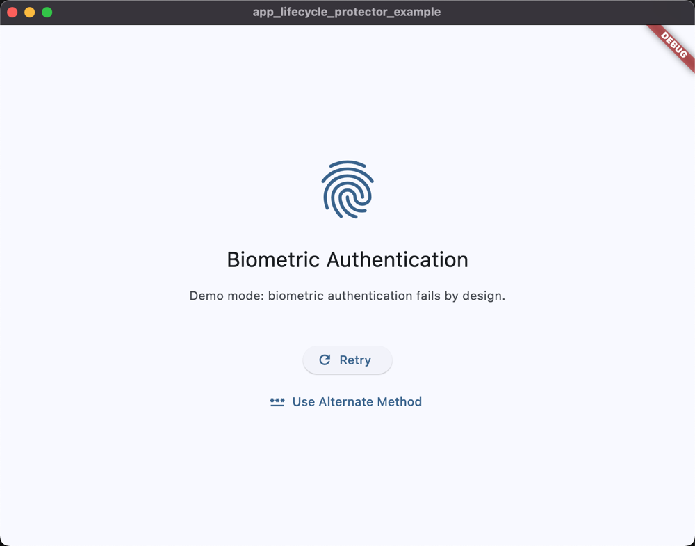
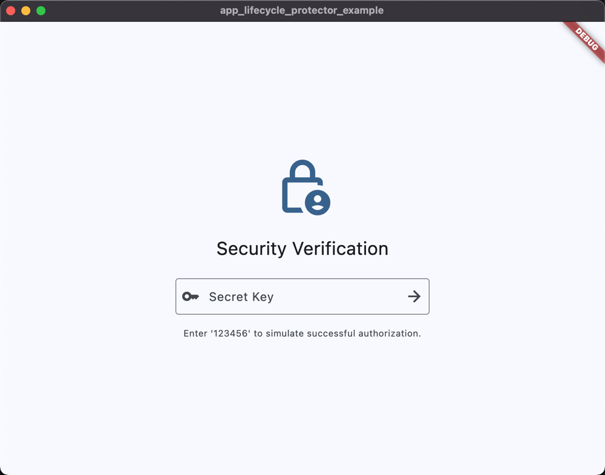
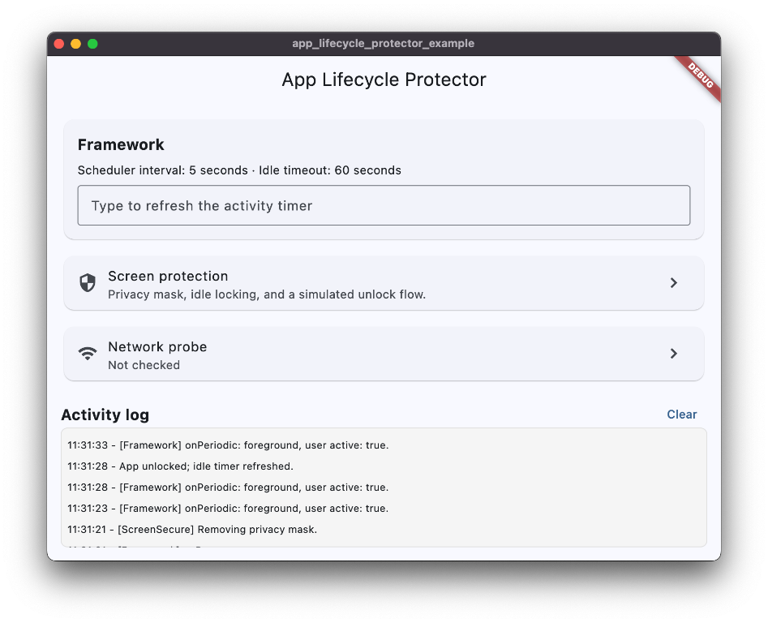
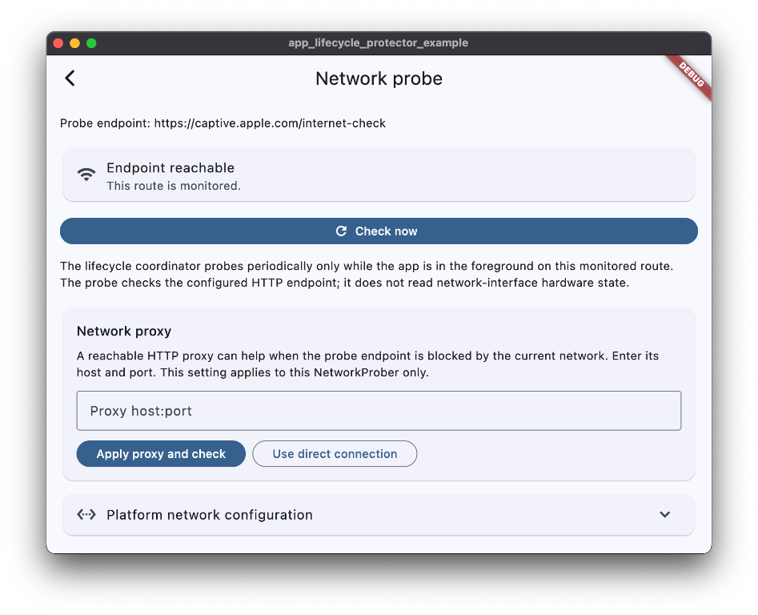

# App Lifecycle Protector

A Flutter lifecycle framework for centralizing app lifecycle events and
periodic tasks, with reusable screen-protection and network-probing features.

[](https://pub.dev/packages/app_lifecycle_protector)
[](https://opensource.org/licenses/MIT)

[English](doc/en/README.md) | [Chinese](doc/zh/README.md)

## What this package provides

The package has two layers: a lifecycle framework and reusable features built
on top of it.

### Lifecycle framework

- **`AppLifecycleEvent`** defines your lifecycle and periodic-task callbacks.
- **`AppLifecycleScheduler`** dispatches lifecycle events and schedules
  periodic calls to your handler.

### Reusable features

- **Screen protection:** `ScreenSecure` holds mask and lock state, and
  `ScreenProtector` displays the corresponding overlay.
- **Network probing:** `NetworkProber` checks a configured HTTP endpoint;
  `RouteSentry` can report whether the current route is monitored.

These features can be used with the lifecycle framework or independently.
The framework can also support additional reusable features in your app.

## Built to adapt to your app

Put lifecycle checks, idle-time decisions, and periodic maintenance in one
handler instead of tying them to visible widgets. The scheduler calls
`onPeriodic()` at the configured interval while the app process is alive and
Flutter can execute Dart code, including in the background. If the operating
system suspends the app, callbacks are delayed until execution is allowed
again.

The screen-protection building blocks are designed to fit your app's security
flow. Supply your own authentication UI, connect packages such as
[`local_auth`](https://pub.dev/packages/local_auth) for biometrics, and use
platform-specific tools such as
[`no_screenshot`](https://pub.dev/packages/no_screenshot) for screenshot
controls.

For network probing, choose an endpoint that represents the service your app
needs, then coordinate checks with lifecycle and route context according to
your app's needs.

## Quick start

Add the package to your Flutter project:

```shell
flutter pub add app_lifecycle_protector
```

Extend `AppLifecycleEvent`, then initialize the scheduler after Flutter's
binding is available. This snippet focuses on lifecycle setup; replace
`MyApp` with your app's root widget:

```dart
import 'package:flutter/widgets.dart';
import 'package:app_lifecycle_protector/app_lifecycle_protector.dart';

class AppEvents extends AppLifecycleEvent {
  @override
  void onResume() {
    // Refresh app data.
  }

  @override
  void onPeriodic() {
    if (isInForeground) {
      // Work that should run while the app is visible.
    } else {
      // Work that may run while the app is hidden and still executing.
    }
  }
}

void main() {
  WidgetsFlutterBinding.ensureInitialized();
  AppLifecycleScheduler.initialize(
    interval: const Duration(seconds: 5),
    event: AppEvents(),
  );
  runApp(const MyApp()); // Replace with your app's root widget.
}
```

`initialize()` creates the global scheduler once. Dispose it with
`AppLifecycleScheduler.instance.dispose()` when the owning app scope ends.
The first periodic callback occurs after the configured interval.

## Documentation

| Topic | Guides |
| --- | --- |
| Framework overview | [English](doc/en/README.md) · [Chinese](doc/zh/README.md) |
| Screen protection | [English](doc/en/screen_secure.md) · [Chinese](doc/zh/screen_secure.md) |
| Network probing | [English](doc/en/network_prober.md) · [Chinese](doc/zh/network_prober.md) |

## Example app

The runnable Flutter app in [`example/`](example/) demonstrates the lifecycle
framework, screen protection, and network probing. Read the
[example guide](example/example.md) for the walkthrough, source-code map,
platform network configuration notes, and proxy setup.

```shell
cd example
flutter run
```

The example is intended for learning and experimentation. Feel free to copy
its source into your own project and adapt it to your app.

### Example screens

The app starts with a simulated biometric prompt and offers a passphrase
fallback. These screens demonstrate the sample authentication flow; they are
not production authentication:

| Simulated biometric prompt | Passphrase fallback |
| --- | --- |
|  |  |

After unlocking, the home screen shows the lifecycle framework status and
entry points to the feature demos.



The network probe screen shows endpoint reachability, route monitoring, proxy
configuration, and platform network guidance:



## Real-world integration

The [ChaBox](https://github.com/huanguan1978/chacrypt/tree/main/chabox)
desktop application in the ChaCrypt ecosystem uses this package as one part
of its application security design. Its implementation is a practical
reference for how to combine lifecycle handling and this package's screen
protection primitives with app-specific authentication and platform
capabilities. In particular, explore how a larger application can bring
together:

- access control when the app launches and after a period of inactivity;
- user-activity tracking to support idle-timeout decisions;
- lifecycle-triggered masking to reduce exposure when switching away from
  the app;
- biometric or passphrase authentication flows; and
- platform-specific screenshot and recording protections.

The package provides reusable lifecycle and UI-protection building blocks;
authentication and operating-system-level capture protections come from the
app's own logic and platform integrations. Explore the
[ChaCrypt repository](https://github.com/huanguan1978/chacrypt) to study how
these pieces fit into a real application.

## Support

If you find this package useful, consider starring the
[GitHub repository](https://github.com/huanguan1978/app_lifecycle_protector)
or liking it on [pub.dev](https://pub.dev/packages/app_lifecycle_protector).
You can also support the developer through
[GitHub Sponsors](https://github.com/sponsors/huanguan1978),
[Buy Me a Coffee](https://buymeacoffee.com/huanguan1978), or
[Ifdian](https://ifdian.net/a/huanguan1978).

## License

MIT License. See [LICENSE](LICENSE).
