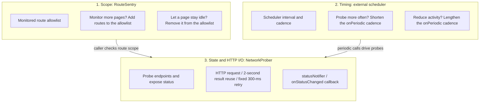
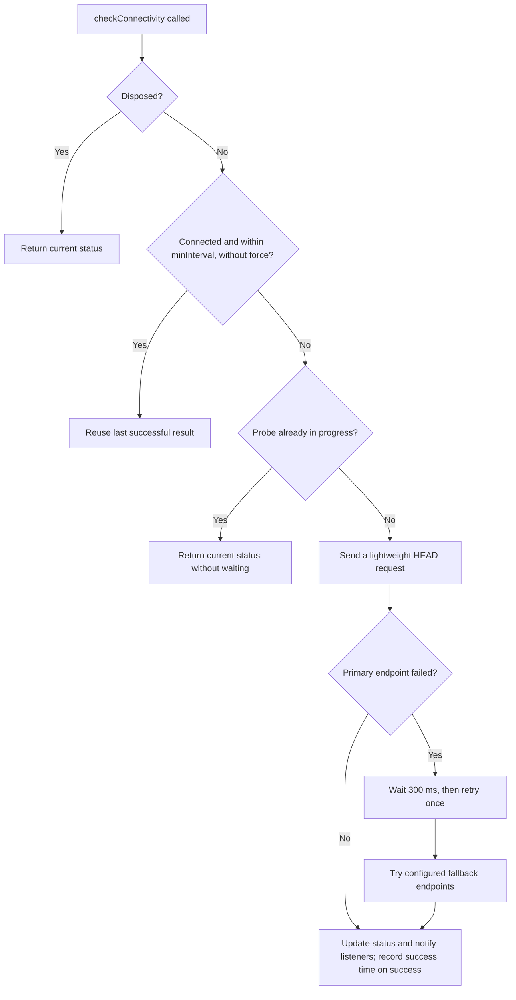

# Network Probing: `NetworkProber` Integration and Best Practices

This guide explains how to use `NetworkProber`, a lightweight HTTP probe built
with Dart and Flutter's standard libraries, together with
`AppLifecycleScheduler` and `RouteSentry`. The prober checks a configured
endpoint to determine whether the network or service represented by that
endpoint is reachable. Choose an endpoint that reflects the network or service
your app needs to access to get a useful indication of its availability.

## 1. Why use an HTTP-based probe?

Some traditional connectivity-checking approaches have limitations:

1. **They may run without regard to app lifecycle.** A poller that is not
   coordinated with foreground and background state may continue sending
   requests after the app is backgrounded or the device is locked.
2. **Probe frequency can be difficult to control.** Excessive requests
   increase traffic, device energy use, and server load. The actual impact
   depends on the device, network, and request frequency.
3. **They may not account for the current route.** Polling every page,
   including offline, static-reading, or settings pages, can create
   unnecessary requests.
4. **They may require access to network hardware.** Some connectivity plugins,
   such as `connectivity_plus` on Linux, inspect network interfaces. Packaged
   apps using restricted permissions (for example, Flatpak or Snap) may need
   permission to access network hardware for that approach. `NetworkProber`
   instead makes an HTTP request to check whether a target service is
   reachable; it does not inspect network interfaces and therefore does not
   need that hardware access permission.

## 2. Architecture: three separate responsibilities

`NetworkProber` uses Dart and Flutter standard libraries, so it adds no
third-party dependency for probing. The design separates three cooperating
responsibilities:



### Clear separation of responsibilities

1. **Where to probe — `RouteSentry` and the caller**
   - Add routes to `RouteSentry(monitoredRoutes: {...})` to expand the
     monitored area.
   - `RouteSentry` exposes whether the current route is monitored. Check
     `isMonitoredRoute` at the call site, such as in a periodic task. It does
     not prevent application code from calling the prober directly.
2. **When to probe — `AppLifecycleScheduler` and `onPeriodic()`**
   - To probe more frequently, shorten the cadence in the external scheduler
     (for example, check every 3 seconds while disconnected).
   - To reduce activity, lengthen the cadence (for example, check every
     12 seconds while connected).
3. **How to probe and expose status — `NetworkProber`**
   - The prober handles HTTP I/O, result reuse, retries, and status.
   - It exposes status through the listenable `statusNotifier` and the
     `onStatusChanged` callback, which the UI and application state can consume.

## 3. Result reuse and concurrent-call protection

`NetworkProber` does not send an HTTP request every time it is called. It
applies several safeguards to reduce unnecessary requests:



1. **Time-window result reuse:** The prober records `_lastSuccessTime`. While
   the `minInterval` cooldown is active (2 seconds by default), if the current
   status is connected and `force: true` was not supplied, it returns `true`
   using the previous successful result instead of sending another request.
2. **In-flight request guard:** `_isChecking` prevents simultaneous probes.
   A call made while a probe is in progress returns the current status
   immediately; it neither waits for nor shares the result of that request.
3. **Fixed-delay retry:** After the first failed probe, the prober waits
   300 ms and retries once. This can reduce false negatives from transient
   failures; it is not an exponential or randomized backoff strategy.

## 4. Choosing a polling cadence

| Setting | Suggested value | Trade-off and behavior |
| :--- | :---: | :--- |
| **Scheduler interval `interval`** | `3 seconds` | Provides a base cadence for alive checks, UI status updates, and probing. |
| **Probe connection timeout `timeout`** | `1.5–2 seconds` | Choose a duration that fits the app's needs. This configures the connection timeout, not the total duration of the entire probe flow. A probe can span multiple scheduler ticks, so do not assume it will finish before the next tick. |
| **Result-reuse cooldown `minInterval`** | `2 seconds` | Avoids repeated requests when users quickly navigate between pages or trigger checks repeatedly. |
| **Connected-state check cadence** | `12–15 seconds` (4–5 ticks) | Connectivity is less likely to change from moment to moment; a longer interval reduces request volume. |
| **Disconnected-state retry cadence** | `3 seconds` (1 tick) | Improves recovery detection. If the process is still running and the current route is monitored, a later check can detect restored connectivity. |

## 5. Complete integration example

### 5.1 Lifecycle event handler (`lifecycle_event.dart`)

Inject `NetworkProber` into the lifecycle event handler. Use `onPeriodic()`
to adapt the probe cadence to the current status:

```dart
import 'package:app_lifecycle_protector/app_lifecycle_protector.dart';

class MyLifecycleEvent extends AppLifecycleEvent {
  MyLifecycleEvent({this.prober});

  final NetworkProber? prober;
  int _tick = 0;

  @override
  void initialize() {
    super.initialize();
    final networkProber = prober;
    if (networkProber == null) return;

    // If no RouteSentry is attached, every route is treated as monitored.
    if (!networkProber.isMonitoredRoute) return;
    networkProber.checkConnectivity();
  }

  @override
  void onResume() {
    super.onResume();
    final networkProber = prober;
    if (networkProber == null) return;

    // With a RouteSentry configured, probe only on a monitored route.
    if (!networkProber.isMonitoredRoute) return;
    networkProber.checkConnectivity();
  }

  @override
  void onPeriodic() {
    super.onPeriodic();

    // 1. Run the network-probe cadence independently.
    _tickNetworkProber();

    // 2. Other app-level periodic work can continue here.
    // checkTokenExpiry();
    // checkIdleTimeout();
  }

  void _tickNetworkProber() {
    final activeProber = prober;
    if (activeProber == null) return;

    // This example probes only in the foreground on a monitored route.
    // Design a separate policy if your app needs background probing.
    if (isInForeground && activeProber.isMonitoredRoute) {
      _tick++;

      // Check every 3 seconds while disconnected and every 12 seconds while connected.
      final shouldCheck = activeProber.isDisconnected || (_tick % 4 == 0);
      if (shouldCheck) {
        activeProber.checkConnectivity();
      }
    } else {
      // Reset the cadence when leaving a monitored route or the foreground.
      _tick = 0;
    }
  }

  @override
  void dispose() {
    prober?.dispose();
    super.dispose();
  }
}
```

### 5.2 Root widget and route observer (`main.dart` / `app.dart`)

Initialize the components in the root widget's `initState`. Attach
`RouteSentry` to Flutter's `MaterialApp` route observer list, and optionally
use `onStatusChanged` to synchronize application-wide state:

```dart
import 'package:flutter/material.dart';
import 'package:app_lifecycle_protector/app_lifecycle_protector.dart';

class MyApp extends StatefulWidget {
  const MyApp({super.key});

  @override
  State<MyApp> createState() => _MyAppState();
}

class _MyAppState extends State<MyApp> {
  late final RouteSentry _routeSentry;
  late final NetworkProber _networkProber;
  late final AppLifecycleScheduler _scheduler;

  @override
  void initState() {
    super.initState();

    // 1. List routes where network health should be monitored.
    _routeSentry = RouteSentry(
      monitoredRoutes: const {
        '/talking/gencontent',
        '/talking/chat',
        '/checkout',
      },
    );

    // 2. Create the prober and optionally synchronize app-wide state.
    _networkProber = NetworkProber(
      onStatusChanged: (status) {
        AppGlobal.shareData['isOnline'] =
            status == NetworkStatus.connected;
      },
    );
    _networkProber.attachRouteMonitor(_routeSentry);

    // 3. Start the lifecycle scheduler.
    AppLifecycleScheduler.initialize(
      interval: const Duration(seconds: 3),
      event: MyLifecycleEvent(prober: _networkProber),
    );
    _scheduler = AppLifecycleScheduler.instance;
  }

  @override
  void dispose() {
    _scheduler.dispose();
    _routeSentry.dispose();
    super.dispose();
  }

  @override
  Widget build(BuildContext context) {
    return MaterialApp(
      initialRoute: '/home',
      // Attach RouteSentry to Flutter's route observer list.
      navigatorObservers: [_routeSentry],
      routes: {
        '/home': (context) => const HomePage(),
        // These monitored routes enable periodic probing.
        '/talking/gencontent': (context) => const GenContentPage(),
        '/talking/chat': (context) => const ChatPage(),
      },
    );
  }
}
```

## 6. Common usage patterns

### Scenario 1: Preflight check before a key action

Before an important network operation, such as sending a message, starting an
AI stream, or signing a transaction, run a lightweight preflight check.

- **On a monitored route such as `/chat`:** The prober may be within its
  2-second cooldown and reuse the last successful result without sending a
  request.
- **On an unmonitored route such as `/home`:** The periodic handler will not
  poll, but application code can still explicitly run a one-off check. The
  duration depends on the network and timeout configuration.

```dart
Future<void> onUserSubmit() async {
  // This checks endpoint reachability; the business request still needs
  // its own network-error handling.
  final isConnected = await prober.checkConnectivity();
  if (!isConnected) {
    AppGlobal.showSnackBar(
      'Network unavailable. Please check your internet connection.',
    );
    return;
  }

  await doSubmit();
}
```

### Scenario 2: Check a specific backend or metadata endpoint

To check a particular service, use `probeUri` (an instance method that
inherits the prober's proxy, certificate, and timeout configuration) or
`NetworkProber.probe` (a static convenience method):

```dart
// A: Use the current prober configuration for a one-off endpoint check.
final isApiReachable = await prober.probeUri(
  Uri.parse('https://api.yourdomain.com/healthz'),
);

// B: Perform a one-off probe without creating a NetworkProber instance.
final isHealthy = await NetworkProber.probe(
  Uri.parse('https://api.yourdomain.com/healthz'),
  timeout: const Duration(seconds: 2),
);
```

### Scenario 3: Bind the UI to probe status

Pages do not need their own timer. Use Flutter's `ValueListenableBuilder` to
listen to `statusNotifier` and rebuild only when the status changes:

```dart
class ChatPage extends StatelessWidget {
  const ChatPage({super.key, required this.prober});

  final NetworkProber prober;

  @override
  Widget build(BuildContext context) {
    return Scaffold(
      appBar: AppBar(title: const Text('Chat')),
      body: Column(
        children: [
          ValueListenableBuilder<NetworkStatus>(
            valueListenable: prober.statusNotifier,
            builder: (context, status, _) {
              if (status == NetworkStatus.disconnected) {
                return Container(
                  color: Colors.redAccent,
                  padding: const EdgeInsets.symmetric(vertical: 4),
                  width: double.infinity,
                  child: const Text(
                    'Network offline. Reconnecting...',
                    textAlign: TextAlign.center,
                    style: TextStyle(color: Colors.white, fontSize: 12),
                  ),
                );
              }
              return const SizedBox.shrink();
            },
          ),
          const Expanded(child: ChatMessageListView()),
        ],
      ),
    );
  }
}
```

## 7. Gotchas and best practices

### 7.1 Use named routes when monitoring routes

`RouteSentry` uses `RouteSettings.name` to match routes against the allowlist.
An anonymous route has a `null` name and cannot match:

```dart
// Avoid: this route has no name for RouteSentry to match.
Navigator.push(
  context,
  MaterialPageRoute(builder: (_) => const ChatPage()),
);

// Prefer a named route.
Navigator.pushNamed(context, '/talking/chat', arguments: args);

// Or provide RouteSettings when pushing a widget directly.
Navigator.push(
  context,
  MaterialPageRoute(
    settings: const RouteSettings(name: '/talking/chat'),
    builder: (_) => const ChatPage(),
  ),
);
```

### 7.2 Reuse a long-lived prober instance

Avoid creating a new `NetworkProber` in a business loop or for every request.
Separate instances do not share their cooldown cache (`_lastSuccessTime`) or
in-flight state (`_isChecking`). Usually, keep one long-lived instance and
provide it through the root widget or your app's state-management layer.

### 7.3 Choose reliable probe endpoints

By default, `NetworkProber` uses Apple's captive-portal check endpoint,
`https://captive.apple.com/internet-check`. That endpoint may be affected by
regional availability, network policies, or service status. For a specific
business service, prefer a health-check endpoint that represents the service
your app needs, and configure fallback endpoints when appropriate.
