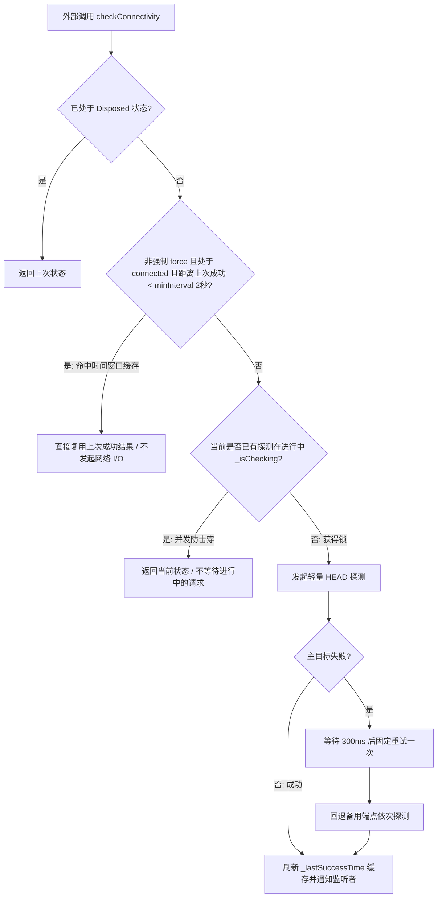

# 网络探针：NetworkProber 架构集成与最佳实践

> 本文是 `NetworkProber` 的功能详解，介绍如何将这个基于 Dart/Flutter 标准库实现的轻量级网络探针，与生命周期调度器（`AppLifecycleScheduler`）和路由哨兵（`RouteSentry`）组合使用。它通过探测配置的端点，判断该端点所代表的目标网络或服务当前是否可达；将探测端点配置为你实际需要访问的网络或服务，可据此了解其当前可用性。

---

## 一、 为什么抛弃传统第三方网络检测库？

在传统 Flutter 开发中，第三方网络检测库（如旧式基于轮询的连接检查包）通常存在以下系统级硬伤：

1. **脱离生命周期，盲目常驻发包**：
   缺乏与应用前后台状态的联动，可能在 App 进入后台或手机锁屏后仍持续向外部公共 DNS/服务器发送请求。
2. **探测频率缺乏控制**：
   过于频繁的请求会增加网络流量、设备能耗和服务端负载；实际影响取决于设备、网络和请求频率。
3. **缺乏路由上下文感知**：
   如果在所有页面（包括纯离线页面、静态阅读页、设置页）无差别轮询，会增加不必要的服务端请求量。
4. **减少应用发布时的权限要求**：
   部分网络检测库（如 `connectivity_plus` 在 `linux`系统上时）通过读取网卡状态判断网络，发布为 Flatpak、Snap 应用时可能需要开放网络硬件权限。`NetworkProber` 通过 HTTP 请求检查目标服务能否连通，不读取网卡，因此无需这项权限。

---

## 二、 架构核心：三维正交解耦模型

`NetworkProber` 的探测实现使用 Dart/Flutter 标准库，无需为探针增加第三方依赖。整体方案将网络状态感知拆解为三个相互配合的维度：


### 职责严格划分
1. **空间范围（Where / 监控范围） $\to$ 由 `RouteSentry` 提供路由状态，并由调用方决定是否探测**：
   * 想扩大网络监控面，就在 `RouteSentry(monitoredRoutes: {...})` 中增加白名单路由；
   * `RouteSentry` 只暴露当前路由是否受监控；应在周期任务等调用点检查 `isMonitoredRoute`。它不会阻止业务代码直接调用探针。
2. **时间节律（When / 轮询频率） $\to$ 由外部主时钟 `AppLifecycleScheduler` + `onPeriodic` 纯粹掌控**：
   * 想提高频次，就在外部时钟调小 tick（比如断网 1 tick / 3s 快查）；
   * 想降频省电，就调大 tick（比如连通 4 ticks / 12s 巡检）。
3. **状态内聚与暴露（What / 状态呈现） $\to$ 由 `NetworkProber` 自身纯粹内聚**：
   * 探针只专注于底层 HTTP I/O、防抖、重试与结果缓存；
   * 通过原生**可监听变量（`statusNotifier`）**与构造函数回调钩子（`onStatusChanged`）向外暴露，供 UI 和全局状态中心自由消费。

---

## 三、 极端优化机制：检测结果缓存与防击穿保护

`NetworkProber` 并不是每次被调用都发起网络 I/O，内部设计了多级防护机制大幅压降网络访问次数：



1. **时间窗口防抖缓存（Time-Window Result Reuse）**：
   探针记录了 `_lastSuccessTime`。在 `minInterval`（默认 2 秒）冷却窗口内，如果当前是连通态且未传 `force: true`，直接根据上次成功结果返回 `true`，不会因此再次发起网络请求。
2. **并发防击穿（In-Flight Request Guard）**：
   通过 `_isChecking` 标记避免同时发起多个探测。当探测正在进行时，新调用会立即返回当前状态，不会等待或共享进行中的请求结果。
3. **固定延迟重试**：
   首次探测失败后等待 300ms 再试一次，降低瞬时失败导致状态误判的概率；这不是随机抖动退避策略。

---

## 四、 时间调度配比黄金法则

| 参数项 | 推荐值 | 工程权衡与底层机理 |
| :--- | :---: | :--- |
| **主时钟周期 `interval`** | `3 秒` | 兼顾应用存活心跳（`isAlive`）、UI 状态轮询与网络检测的基础节律。 |
| **探针连接超时 `timeout`** | `1.5 ~ 2 秒` | 按业务可接受的等待时间设置。此值配置连接超时，不是整个探测流程的总时限；探测可能跨越多个时钟 tick，因此不应假设它必然在下一个 tick 前结束。 |
| **防抖冷却 `minInterval`** | `2 秒` | 避免用户快速连续反复跳转页面或点击时发起密集的并发网络发包。 |
| **连通时巡检周期** | `12 ~ 15 秒`（4~5 ticks） | 连通状态通常不是高频变化；降低巡检频率可减少请求次数。 |
| **断网时重试周期** | `3 秒`（1 tick） | 提高感知灵敏度；进程仍在运行且处于受监控路由时，网络恢复后会在后续巡检中更新状态。 |

---

## 五、 完整实战装配范式（无需额外探针依赖）

### 1. 生命周期事件处理器实现（`lifecycle_event.dart`）

将 `NetworkProber` 注入生命周期事件，通过 `onPeriodic` 完成自适应自律巡检调度：

```dart
import 'package:flutter/foundation.dart';
import 'package:app_lifecycle_protector/app_lifecycle_protector.dart';

class MyLifecycleEvent extends AppLifecycleEvent {
  MyLifecycleEvent({this.prober});

  final NetworkProber? prober;
  int _tick = 0;

  @override
  void initialize() {
    super.initialize();
    final networkProber = prober;
    if (networkProber == null) return;

    // isMonitoredRoute 表示当前页面是否在 RouteSentry 的监控名单中；
    // 未挂载 RouteSentry 时为 true，即不限制页面。
    if (!networkProber.isMonitoredRoute) return;
    networkProber.checkConnectivity();
  }

  @override
  void onResume() {
    super.onResume();
    final networkProber = prober;
    if (networkProber == null) return;

    // 回到前台时再次检查；若配置了 RouteSentry，只在监控名单中的页面探测。
    if (!networkProber.isMonitoredRoute) return;
    networkProber.checkConnectivity();
  }

  @override
  void onPeriodic() {
    super.onPeriodic();

    // 1. 独立执行网络探针巡检节拍（内部自治，绝不阻断后续业务）
    _tickNetworkProber();

    // 2. 后续其他应用级周期任务可安全放置于此（不会被探针提前截断）
    // checkTokenExpiry();
    // checkIdleTimeout();
  }

  void _tickNetworkProber() {
    final activeProber = prober;
    if (activeProber == null) return;

    // 此示例仅在前台且当前路由受监控时巡检；如需后台探测，应另行设计策略。
    if (isInForeground && activeProber.isMonitoredRoute) {
      _tick++;

      // 自适应节拍：断网每 3s（1 tick）查一次，正常连通每 12s（4 ticks）巡检一次
      final shouldCheck = activeProber.isDisconnected || (_tick % 4 == 0);
      if (shouldCheck) {
        activeProber.checkConnectivity();
      }
    } else {
      // 离开监控页面或退到后台：重置计数器，不在此周期发起探测
      _tick = 0;
    }
  }

  @override
  void dispose() {
    prober?.dispose();
    super.dispose();
  }
}
```

---

### 2. 根组件组装与路由哨兵挂载（`main.dart` / `app.dart`）

在应用根组件（如 `StatefulWidget`）的 `initState` 中就地初始化，将 `RouteSentry`、`NetworkProber`、`AppLifecycleScheduler` 与原生 `MaterialApp` 无缝装配，并通过 `onStatusChanged` 顺手同步全局变量：

```dart
import 'package:flutter/material.dart';
import 'package:app_lifecycle_protector/app_lifecycle_protector.dart';

class MyApp extends StatefulWidget {
  const MyApp({super.key});

  @override
  State<MyApp> createState() => _MyAppState();
}

class _MyAppState extends State<MyApp> {
  late final RouteSentry _routeSentry;
  late final NetworkProber _networkProber;
  late final AppLifecycleScheduler _scheduler;

  @override
  void initState() {
    super.initState();

    // 1. 创建路由哨兵，配置需要网络健康监控的核心交互页面白名单
    _routeSentry = RouteSentry(
      monitoredRoutes: const {
        '/talking/gencontent',
        '/talking/chat',
        '/checkout',
      },
    );

    // 2. 创建探针，挂载哨兵，并可选注入全局状态同步钩子
    _networkProber = NetworkProber(
      onStatusChanged: (status) {
        // 当网络状态变化时，自动同步应用全局变量或状态管理中心
        AppGlobal.shareData['isOnline'] = (status == NetworkStatus.connected);
      },
    );
    _networkProber.attachRouteMonitor(_routeSentry);

    // 3. 启动生命周期主时钟调度
    AppLifecycleScheduler.initialize(
      interval: const Duration(seconds: 3),
      event: MyLifecycleEvent(prober: _networkProber),
    );
    _scheduler = AppLifecycleScheduler.instance;
  }

  @override
  void dispose() {
    _scheduler.dispose();
    _routeSentry.dispose();
    super.dispose();
  }

  @override
  Widget build(BuildContext context) {
    return MaterialApp(
      initialRoute: '/home',
      // 4. 将路由哨兵挂载到 Flutter 原生路由观察者列表中
      navigatorObservers: [_routeSentry],
      routes: {
        '/home': (context) => const HomePage(), // 不在白名单：周期处理器不会在此路由发起探测
        '/talking/gencontent': (context) => const GenContentPage(), // 白名单：激活自适应巡检
        '/talking/chat': (context) => const ChatPage(),             // 白名单：激活自适应巡检
      },
    );
  }
}
```

---

## 六、 实战场景使用模式

### 场景 1：关键业务操作前置预检（Pre-flight Check）

在执行重要网络请求（如点击发送消息、AI 流式交互、协议签署）前，执行轻量预检。
* **在白名单页面（如 `/chat`）**：探针可能命中 2 秒防抖窗口，直接复用上次成功结果而不发起新探测；
* **在非白名单页面（如 `/home`）**：周期处理器不会轮询，但业务代码仍可显式发起单次探测；耗时取决于网络与超时设置：

```dart
Future<void> onUserSubmit() async {
  // 预检仅表示探测端点的可达性；实际业务请求仍需处理自身的网络错误
  final isConnected = await prober.checkConnectivity();
  if (!isConnected) {
    AppGlobal.showSnackBar('Network unavailable. Please check your internet connection.');
    return;
  }

  // 执行业务逻辑
  await doSubmit();
}
```

### 场景 2：特定业务后端/元数据端点轻量测活

当需要针对特定业务服务器地址进行快速连通性判定时，使用 `probeUri`（实例方法，自动继承当前代理与证书配置）或 `NetworkProber.probe`（免实例静态方法）：

```dart
// 方式 A：继承探针当前代理/证书/超时配置的实例单点测活
final isApiReachable = await prober.probeUri(
  Uri.parse('https://api.yourdomain.com/healthz'),
);

// 方式 B：一次性轻量免实例快速探测
final isHealthy = await NetworkProber.probe(
  Uri.parse('https://api.yourdomain.com/healthz'),
  timeout: const Duration(seconds: 2),
);
```

### 场景 3：UI 响应式数据绑定（零 setState 开销）

页面无需编写任何定时器，通过 Flutter 原生 `ValueListenableBuilder` 监听探针内置的可监听变量 `statusNotifier` 即可：

```dart
class ChatPage extends StatelessWidget {
  const ChatPage({super.key, required this.prober});

  final NetworkProber prober;

  @override
  Widget build(BuildContext context) {
    return Scaffold(
      appBar: AppBar(title: const Text('Chat')),
      body: Column(
        children: [
          // 仅在网络状态切换时局部精准重绘
          ValueListenableBuilder<NetworkStatus>(
            valueListenable: prober.statusNotifier,
            builder: (context, status, _) {
              if (status == NetworkStatus.disconnected) {
                return Container(
                  color: Colors.redAccent,
                  padding: const EdgeInsets.symmetric(vertical: 4),
                  width: double.infinity,
                  child: const Text(
                    'Network offline. Reconnecting...',
                    textAlign: TextAlign.center,
                    style: TextStyle(color: Colors.white, fontSize: 12),
                  ),
                );
              }
              return const SizedBox.shrink();
            },
          ),
          const Expanded(child: ChatMessageListView()),
        ],
      ),
    );
  }
}
```

---

## 七、 实战避坑指南（Gotchas & Best Practices）

> [!WARNING]
> ### 1. 规避匿名路由跳转导致白名单失效
> `RouteSentry` 依赖 `RouteSettings.name` 识别白名单。
> * **错误做法**：
>   ```dart
>   // 匿名路由的 settings.name 为 null，RouteSentry 无法匹配白名单！
>   Navigator.push(context, MaterialPageRoute(builder: (_) => const ChatPage()));
>   ```
> * **正确做法**：
>   ```dart
>   // 优先使用命名路由
>   Navigator.pushNamed(context, '/talking/chat', arguments: args);
>
>   // 或者必须直接 push Widget 时显式附加 RouteSettings
>   Navigator.push(
>     context,
>     MaterialPageRoute(
>       settings: const RouteSettings(name: '/talking/chat'),
>       builder: (_) => const ChatPage(),
>     ),
>   );
>   ```

> [!IMPORTANT]
> ### 2. 避免在底层无感刷新中重复实例化
> 避免在业务循环或每次发网络请求时临时新建 `NetworkProber`，否则不同实例无法共享各自的时间窗口缓存（`_lastSuccessTime`）和探测状态（`_isChecking`）。通常应将探针作为长效实例，通过根组件注入或由应用状态统一管理。

> [!TIP]
> ### 3. 探针端点高可用建议
> `NetworkProber` 默认使用 Apple Captive Portal 校验端点（`https://captive.apple.com/internet-check`）。该端点可能受地区、网络策略或服务状态影响；面向特定业务时，优先使用可代表目标服务可用性的自有健康检查端点，并按需配置备用端点。
